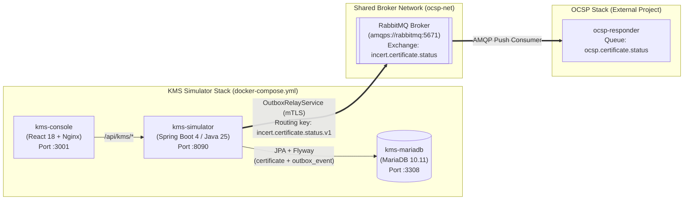

# Incert KMS Simulator & Console

Standalone Key Management System (KMS) Simulator & Certificate Lifecycle Authority for the **Incert OCSP Ecosystem**.

This project acts as the **PKI Certificate Source of Truth** (`kms-simulator` Spring Boot API + `kms-mariadb` database + `kms-console` React 18 UI). It is completely decoupled from the OCSP Responder and communicates certificate status transitions (`GOOD`, `REVOKED`, `CERTIFICATE_HOLD`) **exclusively via RabbitMQ (mTLS)** using the **Transactional Outbox Pattern**.

---

## 1. Architecture Overview



### Key Architectural Principles
- **Zero REST Coupling with OCSP**: The OCSP Responder never calls KMS over HTTP/REST. All certificate issuances, revocations, holds (`CERTIFICATE_HOLD`), and reinstatements are published as asynchronous events to RabbitMQ.
- **Transactional Outbox Pattern**: Every certificate state change in `kms-mariadb` atomically writes both the `certificate` update and an `outbox_event` row in the same database transaction. `OutboxRelayService` polls unsent rows every `500ms` and publishes them to RabbitMQ.
- **Monotonic Per-Certificate Sequence (`sequence`)**: Each status change increments the certificate's `sequence` counter so downstream consumers (`ocsp-responder`) enforce idempotency and reject out-of-order updates.
- **Mutual TLS (mTLS) Broker Authentication**: Connects to `rabbitmq:5671` using PKCS#12 client keystores (`certs/rabbitmq/client-keystore.p12`) and CA truststores (`certs/rabbitmq/client-truststore.p12`).

---

## 2. Project Structure

```text
kms-simulator/
├── Dockerfile                 # Java 25 JRE image for kms-simulator backend
├── docker-compose.yml         # Standalone Compose stack (kms-mariadb, kms-simulator, kms-console)
├── pom.xml                    # Maven build (Spring Boot 4.0.0, Java 25, Flyway, BouncyCastle, AMQP)
├── certs/rabbitmq/            # PKCS#12 keystores & PEMs for RabbitMQ mTLS (port 5671)
├── data/pki/                  # Test PKI hierarchy (Root CA, Intermediate CA, sample EE PEMs)
├── src/main/
│   ├── java/com/company/incert/kms/
│   │   ├── config/            # RabbitMQ mTLS + OpenAPI + Jackson configuration
│   │   ├── controller/        # KmsAdminController (/kms/*) & RootController
│   │   ├── entity/            # Certificate, OutboxEvent, CertificateStatusEvent, RevocationReason
│   │   ├── messaging/         # RabbitMqCertificateEventPublisher
│   │   ├── repository/        # Spring Data JPA repositories
│   │   └── service/           # RevocationService, OutboxRelayService, PkiSeedService, RevocationJob
│   └── resources/
│       ├── application.yml    # Spring Boot & RabbitMQ mTLS configuration
│       └── db/migration/      # Flyway SQL schema migrations (V1..V3)
└── kms-console/               # Dedicated React 18 + TypeScript + Vite + Mantine v7 UI
    ├── Dockerfile             # Multi-stage Node 20 build → Nginx 1.27 Alpine
    ├── nginx.conf             # SPA routing + reverse proxy (/api/kms/* → kms-simulator:8090)
    └── src/
        ├── pages/
        │   ├── KmsCertificatesPage.tsx  # Certificate Inventory, Revoke/Hold/Reinstate, PEM viewer
        │   └── OutboxMonitorPage.tsx    # Live RabbitMQ Outbox Relay & Full Snapshot Publisher
        └── api/client.ts                # Axios client for KMS REST API
```

---

## 3. Prerequisites

- **Docker** (24+) & **Docker Compose** (v2+)
- **Java 25** (Temurin) & **Maven 3.9+** (for local JAR packaging)
- The **OCSP stack** (specifically the `ocsp-net` Docker network and `ocsp-rabbitmq` broker) running if you want live RabbitMQ event delivery to OCSP.
  - If deploying KMS before OCSP, create the shared Docker network once:
    ```bash
    docker network create ocsp-net
    ```

---

## 4. How to Build & Deploy

### Step 1: Ensure Shared Docker Network Exists
The KMS stack connects to the external bridge network `ocsp-net` so it can reach the `rabbitmq` broker container:
```bash
docker network inspect ocsp-net >/dev/null 2>&1 || docker network create ocsp-net
```

### Step 2: Package the Spring Boot Backend JAR
Build the executable JAR in `target/kms-simulator-2.0.0-SNAPSHOT.jar`:
```bash
mvn clean package -DskipTests
```

### Step 3: Build & Start the KMS Stack with Docker Compose
```bash
docker compose up -d --build --wait
```

Verify all three containers are healthy:
```bash
docker compose ps
```

| Container | Service Role | Host Port | Internal Port | Healthcheck |
|---|---|---|---|---|
| `kms-console` | React 18 Admin UI + Nginx Reverse Proxy | `3001` | `80` | `http://127.0.0.1:80/` |
| `kms-simulator` | Spring Boot 4 REST API + Outbox Relay | `8090` | `8090` | `http://localhost:8090/actuator/health` |
| `kms-mariadb` | Dedicated KMS MariaDB 10.11 (`kms` schema) | `3308` | `3306` | `healthcheck.sh --connect` |

---

## 5. Accessing the Application

| Interface | URL | Description |
|---|---|---|
| **KMS Simulator Console (UI)** | http://localhost:3001 | Manage certificate inventory, revoke/hold/reinstate certificates, inspect PEMs, and monitor the RabbitMQ transactional outbox |
| **KMS OpenAPI / Swagger UI** | http://localhost:8090/swagger-ui.html | Interactive OpenAPI documentation for all `/kms/*` endpoints |
| **KMS Actuator Health** | http://localhost:8090/actuator/health | Spring Boot readiness/liveness endpoint |
| **KMS Prometheus Metrics** | http://localhost:8090/actuator/prometheus | Micrometer Prometheus metrics |

---

## 6. REST API Reference (`kms-simulator:8090`)

All endpoints are also proxied through `kms-console` at `http://localhost:3001/api/kms/*`.

| Method | Endpoint | Description |
|---|---|---|
| `GET` | `/kms/certificates` | List all managed certificates and their current statuses |
| `POST` | `/kms/certificates/{serial}/revoke?reason={RFC5280_REASON}` | Revoke a certificate (`KEY_COMPROMISE`, `CA_COMPROMISE`, `AFFILIATION_CHANGED`, `SUPERSEDED`, `CESSATION_OF_OPERATION`, `CERTIFICATE_HOLD`, `PRIVILEGE_WITHDRAWN`, `AA_COMPROMISE`, `UNSPECIFIED`) and relay event to RabbitMQ |
| `POST` | `/kms/certificates/{serial}/unrevoke` | Reinstate a certificate on `CERTIFICATE_HOLD` back to `GOOD` and relay event to RabbitMQ |
| `POST` | `/kms/certificates/{serial}/status` | Explicitly set status (`{"status":"GOOD"|"REVOKED","reason":"..."}`) and relay event to RabbitMQ |
| `GET` | `/kms/audit/sync-status` | Check total certificates and pending unsent `outbox_event` count |
| `POST` | `/kms/audit/sync-all` | Re-publish all managed certificates to the RabbitMQ outbox (`incert.certificate.status`) |
| `POST` | `/kms/certificates/trigger-revocation` | Trigger a single simulated revocation/unrevocation cycle |

### Example CLI Commands

```bash
# 1. Check outbox synchronization status
curl -s http://localhost:8090/kms/audit/sync-status | jq

# 2. Publish full 50-certificate snapshot to RabbitMQ
curl -s -X POST http://localhost:8090/kms/audit/sync-all | jq

# 3. Revoke a certificate by hex serial with reason KEY_COMPROMISE
curl -s -X POST "http://localhost:8090/kms/certificates/8a5232e619344f2ebdb9b35f93e6a70d/revoke?reason=KEY_COMPROMISE" | jq

# 4. Place a certificate on hold (CERTIFICATE_HOLD) and then reinstate it
curl -s -X POST "http://localhost:8090/kms/certificates/8a5232e619344f2ebdb9b35f93e6a70d/revoke?reason=CERTIFICATE_HOLD" | jq
curl -s -X POST "http://localhost:8090/kms/certificates/8a5232e619344f2ebdb9b35f93e6a70d/unrevoke" | jq
```

---

## 7. RabbitMQ Event Contract

Each status change publishes a JSON message to:
- **Exchange**: `incert.certificate.status` (`DirectExchange`, durable)
- **Routing Key**: `incert.certificate.status.v1`
- **Target Queue**: `ocsp.certificate.status` (dead-lettered to `ocsp.certificate.status.dlq`)

```json
{
  "eventId": "f47ac10b-58cc-4372-a567-0e02b2c3d479",
  "sequence": 4,
  "serialNumberHex": "008a5232e619344f2ebdb9b35f93e6a70d",
  "issuerNameHashHex": "2ac877a968b38d2ef57f4b21d9e0f20c1a5b9e84",
  "issuerKeyHashHex": "91c6d4e8b7a53f201e4d8c9a7b6e5f40321d0c9b",
  "status": "REVOKED",
  "revocationTime": "2026-11-15T18:30:00Z",
  "revocationReason": "KEY_COMPROMISE",
  "notBefore": "2026-10-15T12:00:00Z",
  "notAfter": "2027-11-15T12:00:00Z",
  "occurredAt": "2026-11-15T18:30:00.112Z"
}
```

---

## 8. Environment Variables (`docker-compose.yml`)

| Variable | Default | Description |
|---|---|---|
| `MARIADB_HOST` | `kms-mariadb` | KMS MariaDB hostname |
| `MARIADB_PORT` | `3306` | KMS MariaDB internal port (`3308` on host) |
| `MARIADB_KMS_DB` | `kms` | Database schema name |
| `MARIADB_KMS_USER` | `kms_app` | Application DB username |
| `MARIADB_KMS_PASSWORD` | `changeme` | Application DB password |
| `RABBITMQ_HOST` | `rabbitmq` | RabbitMQ hostname on `ocsp-net` (must match server TLS SAN) |
| `RABBITMQ_PORT` | `5671` | RabbitMQ AMQPS (mTLS) port (`5672` when TLS is disabled) |
| `RABBITMQ_TLS_ENABLED` | `true` | Enable Mutual TLS (`true` / `false`) |
| `RABBITMQ_USERNAME` | `ocsp_amqp` | RabbitMQ username |
| `RABBITMQ_PASSWORD` | `changeme` | RabbitMQ password |
| `KMS_JOB_REVOCATION_ENABLED` | `false` | Enable periodic background random revocation simulation |

---

## 9. Stopping & Resetting

```bash
# Stop containers (preserving KMS database volume)
docker compose down

# Stop containers and wipe KMS database volume (re-seeds 50 certificates on next startup)
docker compose down -v
```
